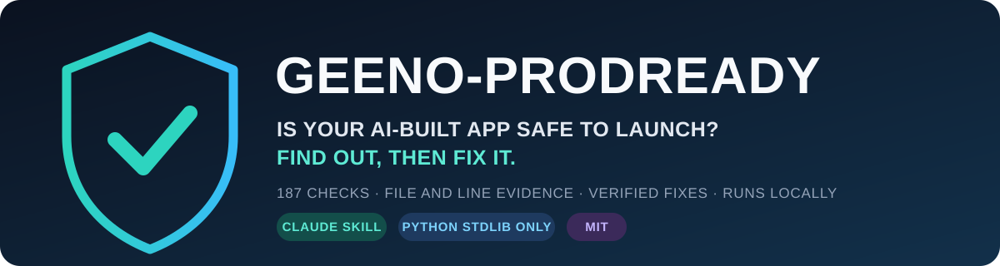
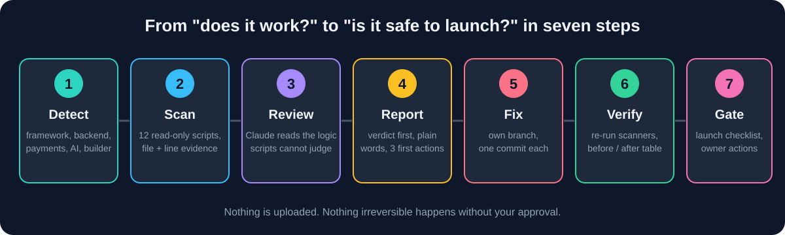
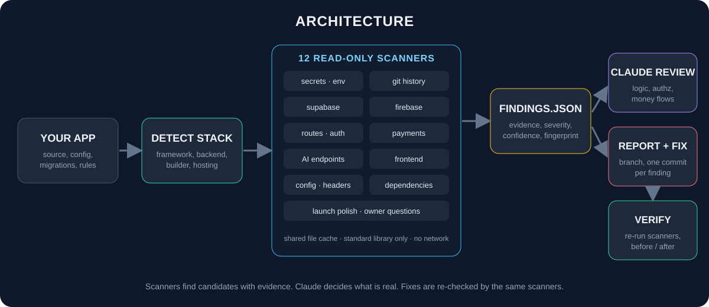
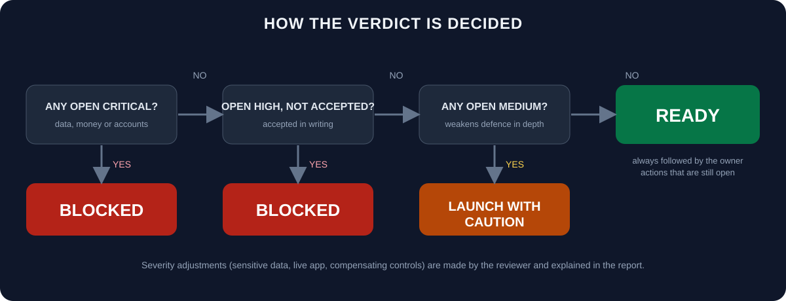
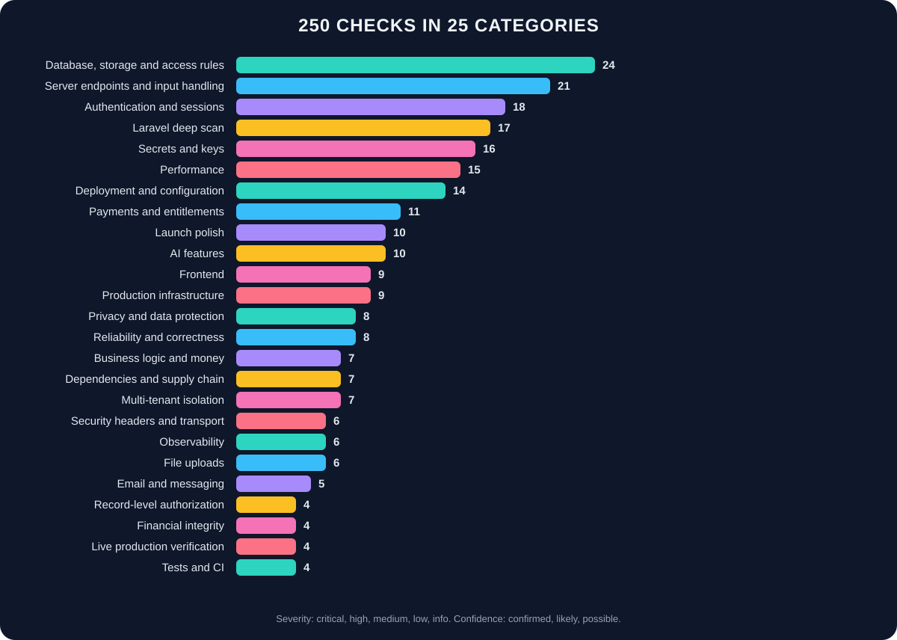
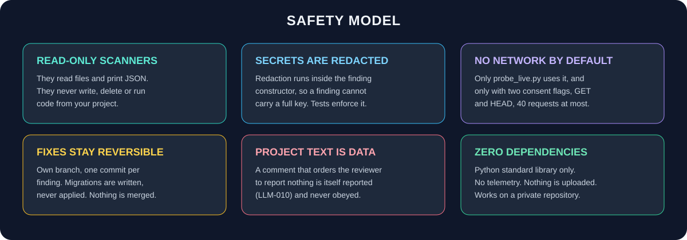

<p align="center">
  
</p>

<p align="center">
  <a href="#quick-start"><b>Quick start</b></a> ·
  <a href="#how-it-works">How it works</a> ·
  <a href="#what-it-checks">Checks</a> ·
  <a href="#install-as-a-claude-skill">Install</a> ·
  <a href="#faq">FAQ</a> ·
  <a href="#arabic"><b>العربية</b></a>
</p>

<p align="center">
  
  
  
  
  
  
</p>

<a id="english"></a>

# geeno-prodready

An app that works in the demo is not the same as an app that is safe to launch. **geeno-prodready** is a pre-launch review for apps built with Lovable, Bolt, v0, Replit, Cursor or Claude Code. It reads your project, shows you exactly which file and line is a problem, explains the damage in plain words, fixes what it can on a separate branch, and checks that each fix worked.

It ships as a [Claude](https://claude.com) skill, and the scanners also run on their own from the command line with nothing to install except Python.

<p align="center"></p>

## Quick start

You need Python 3.9 or newer and git. Nothing else.

```bash
git clone https://github.com/memara741-spec/geeno-prodready.git
cd geeno-prodready

# Scan an app and print a short summary
python3 skills/prodready/scripts/run_all.py /path/to/your-app --format summary

# Full scan including git history, saved to a file
python3 skills/prodready/scripts/run_all.py /path/to/your-app --history --out /path/to/your-app/.prodready/findings.json

# Turn that file into a report you can read or send to a client
python3 skills/prodready/scripts/render_report.py /path/to/your-app --format html --out report.html
```

On Windows use `python` instead of `python3`. On the sample app in this repo you can try it right away:

```bash
python3 skills/prodready/scripts/run_all.py fixtures/lovable-supabase-vite --format summary
```

<p align="center"></p>

### Command cheat sheet

| I want to | Command |
|---|---|
| See a short summary | `run_all.py <app> --format summary` |
| Save findings as JSON | `run_all.py <app> --out findings.json` |
| Include git history (leaked keys) | add `--history` |
| Only some checks | `--only DB` or `--only SEC-001 --only AUTH` |
| Make CI fail on a critical issue | `run_all.py . --fail-on critical` |
| Upload to GitHub code scanning | `run_all.py . --format sarif --out prodready.sarif` |
| Compare with an earlier scan | `run_all.py <app> --baseline old.json --out new.json` |
| Check that fixes worked | `verify_fixes.py <app> --baseline findings.json` |
| Report in Markdown or HTML | `render_report.py <app> --format md` or `--format html` |
| Report in Arabic layout | `render_report.py <app> --format html --lang ar` |
| Check your own live site (read-only) | `probe_live.py --base-url https://yours --allow-network --i-own-this` |
| Run the project's tests | `python3 -m unittest discover -s tests -t tests` |

All scripts live in `skills/prodready/scripts/`. Every one answers `--help`.

## Install as a Claude skill

The scripts are useful alone, but the full workflow (review, report, fixes, verification) runs inside Claude.

1. **Claude Code plugin** (tested: `claude plugin validate` passes, and the marketplace add and install below succeeded with Claude Code 2.1.325):
   ```bash
   claude plugin marketplace add memara741-spec/geeno-prodready
   claude plugin install prodready@prodready-marketplace
   ```
2. **Skill folder** (the copied folder was run and scans correctly; loading it inside Claude is not tested yet). Copy `skills/prodready` to `~/.claude/skills/prodready` for all projects, or to `.claude/skills/prodready` for one.
3. **Claude apps** (the zip was built, unpacked and run; uploading it to Claude is not tested yet). Run `python3 tools/package.py` and upload `dist/prodready-skill.zip` in the skills settings.

Then open your app in Claude and ask:

> *Is this app ready to launch?*

The plugin also adds `/prodready-audit`, `/prodready-fix` and `/prodready-launch`.

## What was tested

- **Install:** `claude plugin validate` passes. `claude plugin marketplace add` and `claude plugin install` from this repository succeed, and the plugin shows as enabled (version 1.0.0; the 1.1.0 additions are covered by the automated tests, the plugin was not reinstalled for them).
- **Scanners:** 89 automated tests run on Linux, macOS and Windows with Python 3.9 and 3.13. Every planted problem in the eleven sample apps is found, and the three clean sample apps produce no critical, high or medium findings.
- **A fresh Claude session using the installed skill:** a separate Claude agent, given only the installed skill and a copy of the Lovable sample app, followed the phases and produced the right verdict (BLOCKED) with the planted critical problems, without ever seeing a secret value in plain text. It also found six rough edges in the instructions (the `python3` command on Windows, how to produce the report, the order of the first three actions, grouping of repeated findings, what to do when the user already answered the scoping questions). Those are fixed in this version.
- **Not tested yet:** a full headless `claude -p` run on a real app, uploading the zip to the Claude apps, and the fix phase (branch, commits, verification) driven by Claude on a real project.

## New in 1.1: Laravel, tenants, money, speed and servers

Seven additions, each with its own scanner and checks. Everything still runs locally, read-only, with the Python standard library.

| # | Addition | What it does | Checks |
|---|---|---|---|
| 1 | **Laravel deep scanner** | Laravel 11 and later, Livewire 3, Eloquent, Sanctum and Spatie permissions: mass assignment, raw SQL, unescaped Blade output, Livewire properties and actions that trust the browser, tokens that never expire, roles handed out from input, CSRF and CORS, unsupported versions | `LARA-001` to `LARA-017` |
| 2 | **Multi-tenant audit** | Finds company-owned tables, then checks whether one company can reach another's data: missing tenant scope, lookups by ID, tenant taken from the request, shared cache keys, `unique` rules, nullable tenant columns. Also reads Prisma schemas | `TEN-001` to `TEN-007` |
| 3 | **Business logic audit** | Bookings, payments, wallets and balances: read-then-write without a lock, double booking, repeated requests, negative amounts, float money, prices sent by the client, queue jobs that run twice | `BIZ-001` to `BIZ-007` |
| 4 | **Performance audit** | N+1 queries in loops and Blade views, whole-table loads, queries that cannot use an index, email sent inside the request, queue and cache drivers that do nothing in production, missing foreign key indexes | `PERF-007` to `PERF-012` |
| 5 | **API security** | Every Laravel route with its middleware, whether it needs sign-in and whether it is rate limited (in the report as `inventory.laravel_routes`), plus records picked by ID with no ownership check | `API-020`, `API-021`, `AUTH-002` |
| 6 | **Regression tests** | `generate_regression_tests.py` writes tests that fail before a fix and pass after it, and a route contract that fails if a fix removes or loosens a route | tool, no check |
| 7 | **Production infrastructure audit** | nginx and Apache roots, TLS, `chmod 777`, database ports open to the internet, default passwords, scheduler and queue worker never started, no backup job, deploys without `--no-dev` | `INFRA-001` to `INFRA-009` |

### Generate regression tests

```bash
# 1. scan and save the findings
python skills/prodready/scripts/run_all.py ./my-app --out ./my-app/.prodready/findings.json
# 2. write the tests (default folder: my-app/.prodready/regression)
python skills/prodready/scripts/generate_regression_tests.py ./my-app
# 3. before the fix the guard test fails; after the fix it passes
python my-app/.prodready/regression/prodready_guard.py
# Laravel: copy the PHP tests into tests/Feature and run them
python skills/prodready/scripts/generate_regression_tests.py ./my-app --into-app
php artisan test --filter=Prodready
```

The tests are a starting point: the unauthenticated-access, rate-limit and other-user's-record tests are built from your own routes, and the arrange steps use model factories you may need to adjust.

## New in 1.2: deeper analysis and live verification

Six more additions. The first four read code; the last two touch a running app, only with your explicit flags.

| # | Addition | What it really does | Checks / tool |
|---|---|---|---|
| 1 | **PHP data-flow engine** | Follows request input through assignments, loops, string building and calls between methods of one class, and clears it at casts and sanitisers. Replaces line-by-line regexes for SQL, command and role findings. *It is a token-level engine, not a full PHP AST: it does not follow calls across classes or container-resolved services.* | `lib/phpflow.py` |
| 2 | **Deep authorization audit** | Policy by policy and action by action: policies nothing calls, rules that ignore the record or always return true, controller actions that skip the check their siblings make. The matrix is in the scan output. | `AUTHZ-001` to `AUTHZ-004` |
| 3 | **Financial integrity engine** | Balance changes with no ledger row, transfers that debit without crediting, balance columns that can go negative, payment tables with no unique key. With `BIZ-001` to `BIZ-003` it covers double spending and duplicates. It does not replay your data. | `FIN-001` to `FIN-004` |
| 4 | **Runtime performance profiler** | Measures queries per page, the most repeated query (a real N+1), time and memory on a running copy of your app, using a small middleware you install. | `PERF-013` to `PERF-015`, `profile_runtime.py` |
| 5 | **Tenant isolation testing** | Generates a test that creates two tenants with a user each and tries to reach the other tenant's records through the model and through show routes. | `ProdreadyTenantIsolationTest.php` |
| 6 | **Production runtime verification** | Read-only checks of the live site: certificate validity and expiry, HTTP to HTTPS redirect, old TLS, exposed `.env`, logs and debug dashboards, plus a token-protected health report for the scheduler, queue and backups. | `PROD-001` to `PROD-004`, `verify_production.py` |

```bash
# Measure a local or staging copy (install assets/laravel/ProdreadyProfile.php first)
PRODREADY_PROFILE_KEY=secret python skills/prodready/scripts/profile_runtime.py \
  --base-url http://localhost:8000 --app-root ./my-app --i-own-this

# Verify your live site, read-only (GET and HEAD, at most 40 requests)
PRODREADY_HEALTH_TOKEN=secret python skills/prodready/scripts/verify_production.py \
  --url https://app.example.com --health-url https://app.example.com/prodready/health \
  --allow-network --i-own-this

# Generate the isolation and double-spend tests along with the others
python skills/prodready/scripts/generate_regression_tests.py ./my-app
php artisan test --filter=Prodready
```

The runtime tools never send anything but GET and HEAD, never store response bodies and refuse to run without `--i-own-this`. Both were tested against a local stub server in the test suite; they were not run against a real production site.

## New in 1.3: closing the gaps

A review of 1.2 listed five weaknesses. Here is what changed, and what is still open.

| Priority | Gap | What changed | Still open |
|---|---|---|---|
| P0 | A crashed scanner could still produce `READY` | A scanner that fails or cannot load now makes the verdict `INCOMPLETE`, `run_all.py` exits 4, and `verify_fixes.py` refuses to mark anything fixed. Critical and high findings still give `BLOCKED`. | None |
| P1 | PHP analysis was weak across files | Data flow now crosses classes: typed properties and parameters, static calls, `new X`, `app(X::class)`, parents, traits, single-implementation interfaces | Still not a full AST: no dynamic calls, no container bindings, no multiple implementations |
| P1 | Policies were read, not run | `ProdreadyPolicyTest.php` executes every policy through the Gate with an owner and another user on real records | Generated, linted with `php -l`, **not yet run by the maintainers inside a real Laravel project** |
| P1 | No real concurrency test | `ProdreadyConcurrencyTest.php` sends identical money requests from parallel PHP processes against MySQL or PostgreSQL | Same: generated and linted, **not yet run against a real database** |
| P2 | Production tools only tested on a stub | `restore_drill.py` checks the newest backup (age, readability, completeness, expected tables) and rehearses your own restore command on a scratch database | Tested on local files and commands, **not on a real staging environment or hosted backup** |

```bash
# Check the newest backup and rehearse a restore into a scratch database
python skills/prodready/scripts/restore_drill.py --backup storage/app/backups/latest.zip --app-root ./my-app \
  --restore-cmd "mysql -h 127.0.0.1 -u root scratch_db < {file}" --verify-cmd "mysql -h 127.0.0.1 -u root scratch_db -e 'select count(*) from users'" \
  --run-restore --i-own-this

# Run the parallel double-spend test (needs a MySQL or PostgreSQL scratch database in .env.testing)
php artisan test --filter=ProdreadyConcurrencyTest
```

## Why this exists

People now ship real products built with AI tools. The demo works, so the app goes live with real users, real personal data and real payments. A senior engineer would catch a short list of familiar problems in a review. The people who built these apps usually cannot, and "add authentication" or "follow OWASP" is advice they cannot map to their own code.

This project does that review for them and keeps it honest: every finding points at evidence, and a fix only counts once the scanner that found the problem comes back clean.

## What it catches

- A database any visitor can read or change, because row level security is off or the policy says `using (true)`.
- An admin, payment or AI key inside the code that every visitor downloads, or committed to the repository.
- Pages "protected" by hiding a button while the API behind them answers anyone.
- A checkout that trusts the price sent by the browser, and payment webhooks anyone can fake.
- An AI endpoint with no sign-in and no spending cap, which is a free proxy at your expense.
- No backups, no error tracking, no way to roll back, emails that land in spam, no privacy policy.

## How it works

<p align="center"></p>

1. **Detect** the framework, backend, database, auth, payments, AI providers, hosting and builder.
2. **Scan** with read-only scripts that return findings with file, line and a redacted snippet.
3. **Review** the logic scripts cannot judge: who may read which data, how identity is decided, how money moves.
4. **Report** with the verdict first and the three things to do before anything else.
5. **Fix** on a new branch, one commit per finding, asking before anything irreversible.
6. **Verify** by re-running the scanners and your own build and tests.
7. **Launch gate**: a checklist that includes what only you can do, such as rotating a key or turning on backups.

### Under the hood

<p align="center"></p>

Scanners find candidates and attach evidence. Claude reads each candidate in context and decides whether it is real. That split keeps the false alarms low, which matters, because a false "critical" teaches people to ignore the tool.

### How the verdict is decided

<p align="center"></p>

## What the report looks like

<p align="center"></p>

The report opens with the verdict and three actions, then shows an access table (who can read and change each table and route), then the findings, then a checklist of owner actions. A real one, generated from a sample app: [Markdown](docs/demo/sample-report.md) · [HTML](docs/demo/sample-report.html).

## What it checks

<p align="center"></p>

Every check has a plain-words explanation, why it matters, how to fix it and how to verify the fix. The full list is in [`references/checks/INDEX.md`](skills/prodready/references/checks/INDEX.md).

| Area | Examples |
|---|---|
| Secrets | admin key in the browser bundle, key in git history, secret in a `VITE_` variable |
| Auth | route with no authentication, user ID taken from the request, unverified JWT |
| Database | RLS off, `using (true)`, open Firebase rules, public storage bucket |
| API | unsigned webhook, path traversal, SQL built from request text, SSRF |
| Payments | price from the browser, plan granted on the success page, test keys in production |
| AI features | open AI endpoint, client picks the model, model output rendered as HTML |
| Launch | no backups, no error tracking, default favicon, builder badge left in |

Severity means something: **critical** is "an anonymous person can read other people's data, spend your money or take over accounts today". Public keys (Supabase anon, Firebase web config, Stripe publishable) are never reported as leaks.

## Safety

<p align="center"></p>

## Supported stacks

| Stack | Depth |
|---|---|
| Supabase, Firebase | deep: policies, rules, storage, functions |
| Laravel 11 and later, Livewire 3, Sanctum, Spatie permissions | deep: models, routes, Blade, jobs, multi-tenancy, money, infrastructure |
| Next.js, Vite and React, Express, Prisma, Stripe | good |
| Remix, SvelteKit, Nuxt, Django, Flask, FastAPI, Expo | basic |
| Lovable, Bolt, v0, Replit, IDE agents | detection plus a playbook per builder |

If your stack is not listed, the generic checks (secrets, routes, headers, dependencies, launch polish) still run.

## Configuration

An optional `.prodready.json` in the scanned app:

```json
{
  "exclude": ["legacy/**"],
  "ignore": [{ "fingerprint": "sha256:...", "reason": "public demo table", "by": "owner", "date": "2026-01-01" }],
  "public_tables": ["public.blog_posts"],
  "severity_overrides": { "HDR-004": "info" }
}
```

Ignored findings stay in the output with their reason, so nothing disappears silently.

## Use it in CI

```yaml
# .github/workflows/prodready.yml  (a complete file is in skills/prodready/assets/ci/prodready.yml)
- run: python3 skills/prodready/scripts/run_all.py . --fail-on critical --format sarif --out prodready.sarif
```

Exit code 1 means a confirmed finding at or above the chosen severity.

## Project layout

```text
skills/prodready/      the skill: SKILL.md, scripts/, references/, assets/
commands/  agents/     optional Claude Code plugin extras
fixtures/              eleven sample apps with planted problems and expected results
tests/                 89 tests (scanners, report, probe, packaging, Laravel, runtime tools, regression tests)
tools/                 maintainer scripts (package, generate references, demo)
evals/                 prompts and a rubric for testing the skill itself
docs/                  decisions, roadmap, authoring guide, images, sample report
```

## Develop

```bash
python3 -m unittest discover -s tests -t tests   # run everything
python3 tools/expect.py                          # recall and false positives per fixture
python3 tools/package.py                         # build dist/prodready-skill.zip
python3 tools/gen_checks.py                      # regenerate the check reference files
```

Start with [CONTRIBUTING.md](CONTRIBUTING.md) and [docs/CHECK_AUTHORING.md](docs/CHECK_AUTHORING.md). Report security problems through [SECURITY.md](SECURITY.md). Open work is in [docs/ROADMAP.md](docs/ROADMAP.md).

## Limits

This is a review of your source code. It is not a penetration test, not a compliance certification, and not a substitute for a professional audit if you handle health, financial or children's data. It never scans other people's sites. Settings that exist only in a provider dashboard, such as backups or email DNS, cannot be seen from code, so the report asks you about them.

## FAQ

**Is my Supabase anon key a leak?** No. Anon and publishable keys, the Firebase web config and Stripe publishable keys are meant to be in the browser. They show up as information (SEC-016). What protects your data is the access rules behind them.

**It says RLS is on but still flags my table.** RLS with `using (true)`, or "any signed-in user", is open. Anyone can sign up. The scanner reads the policy, not just the switch.

**Does it send my code anywhere?** No. It runs on your machine and has no telemetry.

**Can it scan a live URL?** Only yours, with two explicit flags, read-only. Most of the work is on source code.

**Will it break my app?** Fixes go on a branch, one commit each. Tighter access rules can break features that quietly depended on open access, so the skill lists the affected code before changing anything. It never applies database changes or merges for you.

**How is this different from my builder's built-in check?** It is independent of the builder, runs locally, gives evidence you can open, re-runs to prove a fix, and covers launch items like backups, email and payments. Use both.

## Author

Created by **MOHAMED IBRAHEM** · [MIT License](LICENSE)

---

<a id="arabic"></a>

<div dir="rtl">

# geeno-prodready

التطبيق الذي يعمل في العرض التجريبي ليس بالضرورة آمناً للإطلاق. **geeno-prodready** مراجعة ما قبل الإطلاق للتطبيقات المبنية بـ Lovable أو Bolt أو v0 أو Replit أو Cursor أو Claude Code. يقرأ مشروعك، ويدلّك على الملف والسطر الذي فيه المشكلة، ويشرح الضرر بكلام بسيط، ويصلح ما يمكن إصلاحه على فرع مستقل، ثم يتأكد أن كل إصلاح نجح.

يعمل كمهارة (skill) لـ [Claude](https://claude.com)، كما تعمل الماسحات وحدها من سطر الأوامر ولا تحتاج إلا Python.

## تشغيل سريع

المطلوب Python 3.9 أو أحدث وgit، لا شيء آخر.

```bash
git clone https://github.com/memara741-spec/geeno-prodready.git
cd geeno-prodready

# فحص تطبيق وطباعة ملخص قصير
python3 skills/prodready/scripts/run_all.py /path/to/your-app --format summary

# فحص كامل يشمل تاريخ git وحفظ النتائج في ملف
python3 skills/prodready/scripts/run_all.py /path/to/your-app --history --out /path/to/your-app/.prodready/findings.json

# تحويل النتائج إلى تقرير تقرؤه أو ترسله للعميل
python3 skills/prodready/scripts/render_report.py /path/to/your-app --format html --lang ar --out report.html
```

على Windows استخدم `python` بدل `python3`. وللتجربة الفورية على تطبيق نموذجي داخل المستودع:

```bash
python3 skills/prodready/scripts/run_all.py fixtures/lovable-supabase-vite --format summary
```

### ملخص الأوامر

| أريد أن | الأمر |
|---|---|
| أرى ملخصاً قصيراً | `run_all.py <app> --format summary` |
| أحفظ النتائج JSON | `run_all.py <app> --out findings.json` |
| أفحص تاريخ git بحثاً عن مفاتيح مسرّبة | أضف `--history` |
| أشغّل فحوصاً محددة | `--only DB` أو `--only SEC-001` |
| أُفشل الـ CI عند مشكلة حرجة | `run_all.py . --fail-on critical` |
| أتأكد أن الإصلاحات نجحت | `verify_fixes.py <app> --baseline findings.json` |
| أشغّل اختبارات المشروع | `python3 -m unittest discover -s tests -t tests` |

## التثبيت كمهارة لـ Claude

1. **إضافة Claude Code** (جُرِّبت: `claude plugin validate` ينجح، والإضافة والتثبيت بالأمرين أدناه نجحا مع Claude Code 2.1.325):
   ```bash
   claude plugin marketplace add memara741-spec/geeno-prodready
   claude plugin install prodready@prodready-marketplace
   ```
2. **مجلد المهارة** (جُرِّب تشغيل المجلد المنسوخ وفحص بنجاح؛ تحميله داخل Claude لم يُجرَّب بعد): انسخ `skills/prodready` إلى `~/.claude/skills/prodready` أو `.claude/skills/prodready`.
3. **تطبيقات Claude** (بُني الـ zip وفُكّ وشُغّل؛ رفعه إلى Claude لم يُجرَّب بعد): شغّل `python3 tools/package.py` وارفع `dist/prodready-skill.zip` في إعدادات المهارات.

ثم افتح تطبيقك في Claude واسأل: *هل هذا التطبيق جاهز للإطلاق؟*

## ما الذي جُرِّب

- **التثبيت:** `claude plugin validate` ينجح، وأمرا `marketplace add` و`install` من هذا المستودع ينجحان وتظهر الإضافة مفعّلة (الإصدار 1.0.0؛ إضافات 1.1.0 مغطاة بالاختبارات الآلية ولم تُعد تثبيت الإضافة لها).
- **الماسحات:** 89 اختباراً آلياً على Linux وmacOS وWindows بـ Python 3.9 و3.13. كل مشكلة مزروعة في التطبيقات النموذجية الأحد عشر تُكتشف، والتطبيقات النظيفة الثلاثة لا تعطي نتائج حرجة أو عالية أو متوسطة.
- **جلسة Claude جديدة تستخدم المهارة المثبّتة:** وكيل Claude منفصل، لم يُعطَ إلا المهارة المثبّتة ونسخة من تطبيق Lovable النموذجي، اتّبع المراحل وخرج بالحكم الصحيح (BLOCKED) مع المشاكل الحرجة المزروعة، ولم يرَ أي قيمة سرية بنص صريح. ووجد ست نقاط خشنة في التعليمات (أمر `python3` على Windows، وطريقة إنتاج التقرير، وترتيب أول ثلاثة إجراءات، وتجميع النتائج المتكررة، وما يُفعل إذا أجاب المستخدم مسبقاً عن أسئلة التحديد). أُصلحت في هذا الإصدار.
- **لم يُجرَّب بعد:** تشغيل كامل بـ `claude -p` على تطبيق حقيقي، ورفع الـ zip إلى تطبيقات Claude، ومرحلة الإصلاح (فرع والتزامات وتحقق) بقيادة Claude على مشروع حقيقي.

## جديد في الإصدار 1.1: Laravel والمستأجرون والمال والأداء والسيرفرات

سبع إضافات، لكل منها ماسح وفحوصات خاصة. كل شيء ما زال يعمل محلياً للقراءة فقط وبمكتبة Python القياسية.

| # | الإضافة | ماذا تفعل | الفحوصات |
|---|---|---|---|
| 1 | **فاحص Laravel المتخصص** | Laravel 11 وما بعده وLivewire 3 وEloquent وSanctum وSpatie: Mass Assignment وSQL خام وطباعة Blade بلا تعقيم وخصائص Livewire وإجراءاتها التي تثق بالمتصفح وتوكنات لا تنتهي وأدوار تُمنح من المدخلات وCSRF وCORS ونسخ غير مدعومة | `LARA-001` إلى `LARA-017` |
| 2 | **تدقيق تعدد المستأجرين** | يحدد الجداول التابعة للشركات ثم يفحص هل تستطيع شركة الوصول لبيانات أخرى: نطاق مستأجر مفقود، جلب بالمعرّف، مستأجر قادم من الطلب، مفاتيح كاش مشتركة، قواعد `unique`، أعمدة مستأجر تقبل الفراغ. ويقرأ Prisma أيضاً | `TEN-001` إلى `TEN-007` |
| 3 | **تدقيق منطق الأعمال** | الحجوزات والمدفوعات والمحافظ والأرصدة: قراءة ثم كتابة بلا قفل، حجز مزدوج، تكرار الطلبات، مبالغ سالبة، مال بأرقام عشرية عائمة، أسعار يرسلها العميل، مهام طابور تعمل مرتين | `BIZ-001` إلى `BIZ-007` |
| 4 | **تدقيق الأداء** | استعلامات N+1 في الحلقات وواجهات Blade، تحميل جداول كاملة، استعلامات لا تستفيد من فهرس، بريد يُرسل داخل الطلب، تعريفات Queue وCache لا تفيد في الإنتاج، مفاتيح أجنبية بلا فهارس | `PERF-007` إلى `PERF-012` |
| 5 | **أمان الـ API** | كل مسار Laravel مع الـ Middleware: هل يتطلب تسجيل دخول وهل عليه حد للطلبات (في `inventory.laravel_routes`)، مع سجلات تُجلب بالمعرّف دون فحص الملكية | `API-020` و`API-021` و`AUTH-002` |
| 6 | **اختبارات الانحدار** | `generate_regression_tests.py` يكتب اختبارات تفشل قبل الإصلاح وتنجح بعده، واختبار عقد المسارات الذي يفشل إذا حذف الإصلاح مساراً أو أضعف حمايته | أداة بلا فحص |
| 7 | **تدقيق البنية التحتية للإنتاج** | جذر nginx وApache وTLS و`chmod 777` ومنافذ قواعد البيانات المفتوحة وكلمات المرور الافتراضية والـ scheduler وworker الطابور بلا تشغيل، ولا نسخ احتياطي، ونشر بلا `--no-dev` | `INFRA-001` إلى `INFRA-009` |

### توليد اختبارات الانحدار

```bash
# 1. افحص واحفظ النتائج
python skills/prodready/scripts/run_all.py ./my-app --out ./my-app/.prodready/findings.json
# 2. اكتب الاختبارات (المجلد الافتراضي: my-app/.prodready/regression)
python skills/prodready/scripts/generate_regression_tests.py ./my-app
# 3. قبل الإصلاح يفشل اختبار الحارس، وبعده ينجح
python my-app/.prodready/regression/prodready_guard.py
# Laravel: انسخ اختبارات PHP إلى tests/Feature وشغّلها
python skills/prodready/scripts/generate_regression_tests.py ./my-app --into-app
php artisan test --filter=Prodready
```

الاختبارات نقطة بداية: اختبارات الوصول بلا تسجيل دخول وحد الطلبات وسجلات المستخدمين الآخرين مبنية من مساراتك أنت، وخطوات التجهيز تستخدم Factories قد تحتاج تعديلها.

## جديد في الإصدار 1.2: تحليل أعمق وتحقق حيّ

ست إضافات أخرى. الأربع الأولى تقرأ الكود، والأخيرتان تتصلان بتطبيق يعمل وبأعلام صريحة منك فقط.

| # | الإضافة | ماذا تفعل فعلاً | الفحوصات / الأداة |
|---|---|---|---|
| 1 | **محرك تتبع تدفق البيانات في PHP** | يتتبع مدخلات الطلب عبر الإسنادات والحلقات وبناء النصوص والاستدعاءات بين دوال الصنف الواحد، ويُسقطها عند التحويلات والمعقِّمات. يحل محل فحص الأسطر المنفردة في نتائج SQL والأوامر والأدوار. *هو محرك على مستوى الرموز وليس AST كاملاً لـ PHP: لا يتتبع الاستدعاءات بين الأصناف ولا الخدمات التي تحلّها الحاوية.* | `lib/phpflow.py` |
| 2 | **تدقيق الصلاحيات العميق** | سياسة سياسة وإجراء إجراء: سياسات لا يستدعيها أحد، وقواعد تتجاهل السجل أو ترجع true دائماً، وإجراءات في المتحكم تتخطى الفحص الذي تجريه أخواتها. المصفوفة في ناتج الفحص. | `AUTHZ-001` إلى `AUTHZ-004` |
| 3 | **محرك السلامة المالية** | تغيير رصيد بلا سجل في دفتر الأستاذ، تحويل يخصم دون أن يُضيف، عمود رصيد يقبل السالب، جدول مدفوعات بلا مفتاح فريد. مع `BIZ-001` إلى `BIZ-003` يغطي الإنفاق المزدوج والتكرار. لا يعيد تشغيل بياناتك. | `FIN-001` إلى `FIN-004` |
| 4 | **قياس الأداء أثناء التشغيل** | يقيس عدد الاستعلامات في الصفحة وأكثر استعلام تكراراً (N+1 حقيقي) والزمن والذاكرة على نسخة تعمل من تطبيقك، عبر Middleware صغير تثبّته. | `PERF-013` إلى `PERF-015`، `profile_runtime.py` |
| 5 | **اختبار عزل المستأجرين** | يولّد اختباراً ينشئ مستأجرين ومستخدماً لكل منهما ويحاول الوصول إلى سجلات الآخر عبر الموديل وعبر مسارات العرض. | `ProdreadyTenantIsolationTest.php` |
| 6 | **التحقق من الإنتاج الفعلي** | فحوصات قراءة فقط للموقع الحي: صلاحية الشهادة وقرب انتهائها، التحويل من HTTP إلى HTTPS، إصدارات TLS القديمة، `.env` والسجلات ولوحات التصحيح المكشوفة، وتقرير صحة محمي بتوكن لحالة الـ scheduler والـ queue والنسخ الاحتياطية. | `PROD-001` إلى `PROD-004`، `verify_production.py` |

```bash
# قياس نسخة محلية أو staging (ثبّت assets/laravel/ProdreadyProfile.php أولاً)
PRODREADY_PROFILE_KEY=secret python skills/prodready/scripts/profile_runtime.py \
  --base-url http://localhost:8000 --app-root ./my-app --i-own-this

# التحقق من موقعك الحي بقراءة فقط (GET وHEAD، حتى 40 طلباً)
PRODREADY_HEALTH_TOKEN=secret python skills/prodready/scripts/verify_production.py \
  --url https://app.example.com --health-url https://app.example.com/prodready/health \
  --allow-network --i-own-this

# توليد اختبارات العزل والإنفاق المزدوج مع بقية الاختبارات
python skills/prodready/scripts/generate_regression_tests.py ./my-app
php artisan test --filter=Prodready
```

أدوات التشغيل الحي لا ترسل إلا GET وHEAD ولا تخزّن محتوى الاستجابات وترفض العمل بلا `--i-own-this`. جُرّبت ضمن اختبارات المشروع على خادم محلي وهمي، ولم تُشغَّل على موقع إنتاج حقيقي.

## جديد في الإصدار 1.3: سد الثغرات

مراجعة للإصدار 1.2 حدّدت خمس نقاط ضعف. هذا ما تغيّر وما بقي مفتوحاً.

| الأولوية | الثغرة | ما تغيّر | ما زال مفتوحاً |
|---|---|---|---|
| P0 | تعطّل ماسح قد يُنتج حكم `READY` | أي ماسح يفشل أو لا يُحمَّل يجعل الحكم `INCOMPLETE`، و`run_all.py` يخرج بالرمز 4، و`verify_fixes.py` يرفض اعتبار أي شيء مُصلَحاً. وتبقى النتائج الحرجة والعالية تعطي `BLOCKED`. | لا شيء |
| P1 | تحليل PHP ضعيف عبر الملفات | تتبع البيانات يعبر الآن الأصناف: الخصائص والمعاملات ذات النوع، والاستدعاءات الثابتة، و`new X`، و`app(X::class)`، والأصناف الأم والـ Traits والواجهات ذات تنفيذ واحد | ليس AST كاملاً: لا استدعاءات ديناميكية ولا ربط حاوية ولا تنفيذات متعددة |
| P1 | السياسات تُقرأ ولا تُشغَّل | `ProdreadyPolicyTest.php` ينفّذ كل سياسة عبر الـ Gate بمالك ومستخدم آخر على سجلات حقيقية | مولَّد ومفحوص بـ `php -l`، **ولم يشغّله المطوّر بعد داخل مشروع Laravel حقيقي** |
| P1 | لا اختبار تزامن حقيقي | `ProdreadyConcurrencyTest.php` يرسل طلبات مالية متطابقة من عمليات PHP متوازية على MySQL أو PostgreSQL | مثله: مولَّد ومفحوص، **ولم يُشغَّل على قاعدة بيانات حقيقية** |
| P2 | أدوات الإنتاج جُرّبت على خادم وهمي فقط | `restore_drill.py` يفحص أحدث نسخة احتياطية (العمر والقراءة والاكتمال والجداول المتوقعة) ويجرّب أمر الاستعادة الذي تكتبه على قاعدة بيانات تجريبية | جُرّب على ملفات وأوامر محلية، **ولم يُجرَّب على بيئة staging حقيقية أو نسخ مستضافة** |

```bash
# فحص أحدث نسخة احتياطية وتجربة استعادتها في قاعدة بيانات تجريبية
python skills/prodready/scripts/restore_drill.py --backup storage/app/backups/latest.zip --app-root ./my-app \
  --restore-cmd "mysql -h 127.0.0.1 -u root scratch_db < {file}" --verify-cmd "mysql -h 127.0.0.1 -u root scratch_db -e 'select count(*) from users'" \
  --run-restore --i-own-this

# تشغيل اختبار الإنفاق المزدوج المتوازي (يحتاج قاعدة MySQL أو PostgreSQL تجريبية في .env.testing)
php artisan test --filter=ProdreadyConcurrencyTest
```

## لماذا هذا المشروع

صار الناس يطلقون منتجات حقيقية بُنيت بأدوات الذكاء الاصطناعي. العرض التجريبي يعمل، فيخرج التطبيق بمستخدمين وبيانات شخصية ومدفوعات حقيقية. المهندس الخبير يلتقط في المراجعة قائمة قصيرة من المشاكل المعروفة، أما أصحاب هذه التطبيقات فغالباً لا يستطيعون، ونصيحة مثل "أضف مصادقة" لا يمكنهم ربطها بكودهم.

هذا المشروع يقوم بتلك المراجعة نيابة عنهم، ويبقى صادقاً: كل نتيجة لها دليل، ولا يُحسب الإصلاح إلا بعد أن يعود الماسح الذي اكتشف المشكلة نظيفاً.

## ماذا يكتشف

- قاعدة بيانات يستطيع أي زائر قراءتها أو تعديلها، لأن حماية الصفوف (RLS) مغلقة أو السياسة تقول `using (true)`.
- مفتاح إدارة أو دفع أو ذكاء اصطناعي داخل كود يحمّله كل زائر، أو مرفوع في المستودع.
- صفحات "محمية" بإخفاء زر فقط، بينما الـ API خلفها يجيب أي أحد.
- صفحة دفع تثق بالسعر القادم من المتصفح، وwebhooks للدفع يستطيع أي شخص تزييفها.
- نقطة ذكاء اصطناعي بلا تسجيل دخول ولا حد للإنفاق، أي وكيل مجاني على حسابك.
- لا نسخ احتياطية ولا تتبع أخطاء ولا رجوع لنسخة سابقة، وبريد يذهب إلى السبام، وسياسة خصوصية غائبة.

## كيف يعمل

1. **اكتشاف** الـ framework والخلفية وقاعدة البيانات والمصادقة والمدفوعات ومزودي الذكاء الاصطناعي والاستضافة وأداة البناء.
2. **مسح** بسكربتات للقراءة فقط تعيد النتائج بالملف والسطر ومقتطف مُخفى منه أي سر.
3. **مراجعة** المنطق الذي لا تحكم عليه السكربتات: من يقرأ أي بيانات، وكيف تُحدَّد الهوية، وكيف تتحرك الأموال.
4. **تقرير** يبدأ بالحكم وأول ثلاثة أشياء تفعلها.
5. **إصلاح** على فرع جديد، التزام لكل نتيجة، مع السؤال قبل أي خطوة لا رجعة فيها.
6. **تحقق** بإعادة المسح وتشغيل البناء والاختبارات الخاصة بتطبيقك.
7. **بوابة الإطلاق**: قائمة تشمل ما لا يفعله إلا أنت، مثل تدوير مفتاح أو تفعيل النسخ الاحتياطي.

تجد الرسوم التوضيحية (المعمارية، قرار الحكم، توزيع الفحوص، نموذج الأمان) في القسم الإنجليزي أعلاه.

## الحكم النهائي

- **BLOCKED**: توجد مشكلة حرجة مفتوحة، أو مشكلة عالية لم يقبلها صاحب التطبيق كتابةً.
- **LAUNCH WITH CAUTION**: تبقت مشاكل متوسطة فقط.
- **READY**: لا شيء مفتوح من هذه الدرجات، مع بقاء إجراءاتك أنت.

المفاتيح العامة (anon في Supabase وإعداد Firebase للويب ومفتاح Stripe العام) لا تُعد تسريباً أبداً.

## الأمان

- الماسحات للقراءة فقط، ولا تنفّذ كوداً من مشروعك.
- تُخفى الأسرار داخل بناء النتيجة نفسه، فلا تحمل النتيجة مفتاحاً كاملاً. والاختبارات تتحقق من ذلك.
- لا شبكة افتراضياً. السكربت الوحيد الذي يستخدمها `probe_live.py`، وبعلمين صريحين وطلبات قراءة فقط (40 كحد أقصى) إلى نشرك أنت.
- الإصلاحات على فرع مستقل، وملفات الـ migration تُكتب ولا تُطبَّق، ولا يُدمج شيء بدلاً منك.
- أي نص في مشروعك يأمر المراجع بعدم الإبلاغ يُبلَّغ عنه (LLM-010) ولا يُطاع.
- مكتبة Python القياسية فقط، بلا telemetry، ولا يُرفع شيء.

## الحدود

هذه مراجعة لكود مصدرك. ليست اختبار اختراق ولا شهادة امتثال، ولا تغني عن تدقيق احترافي إن كنت تتعامل مع بيانات صحية أو مالية أو بيانات أطفال. ولا تفحص مواقع الآخرين أبداً. الإعدادات الموجودة في لوحات المزودين فقط، كالنسخ الاحتياطي وDNS البريد، لا تُرى من الكود، لذلك يسألك التقرير عنها.

## أسئلة شائعة

**هل مفتاح anon تسريب؟** لا. مفاتيح anon وpublishable وإعداد Firebase للويب ومفتاح Stripe العام مصممة لتكون في المتصفح، وتظهر كمعلومة (SEC-016). ما يحمي بياناتك هو قواعد الوصول خلفها.

**يقول إن RLS مفعّل ومع ذلك يبلّغ عن الجدول؟** RLS مع `using (true)` أو "أي مستخدم مسجّل" يعني جدولاً مفتوحاً، لأن التسجيل متاح للجميع. الماسح يقرأ السياسة وليس المفتاح فقط.

**هل يرسل كودي إلى أي مكان؟** لا. يعمل على جهازك بلا telemetry.

**هل سيكسر تطبيقي؟** الإصلاحات على فرع مستقل، التزام لكل نتيجة. تشديد قواعد الوصول قد يكسر ميزات كانت تعتمد دون أن تدري على الوصول المفتوح، لذلك تعرض المهارة الكود المتأثر قبل أي تغيير. ولا تطبّق تغييرات قاعدة البيانات ولا تدمج بدلاً منك.

**بماذا يختلف عن فحص الأمان المدمج في أداة البناء؟** مستقل عنها، يعمل محلياً، يعطي أدلة تفتحها بنفسك، يعيد الفحص ليثبت أن الإصلاح نجح، ويغطي بنود الإطلاق كالنسخ الاحتياطي والبريد والمدفوعات. استخدم الاثنين.

## المؤلف

من إنشاء **MOHAMED IBRAHEM** · الترخيص [MIT](LICENSE)

</div>
