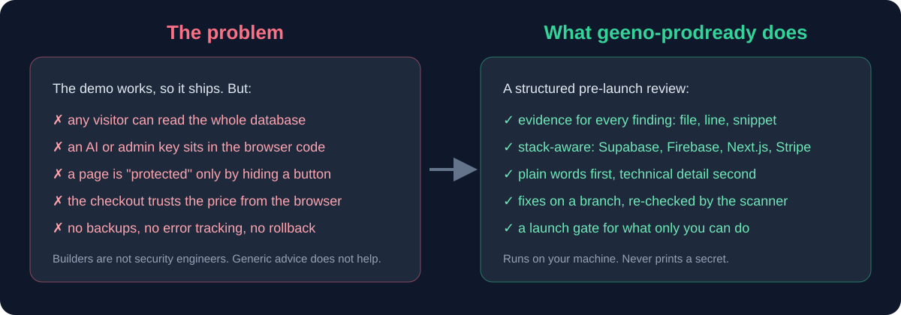
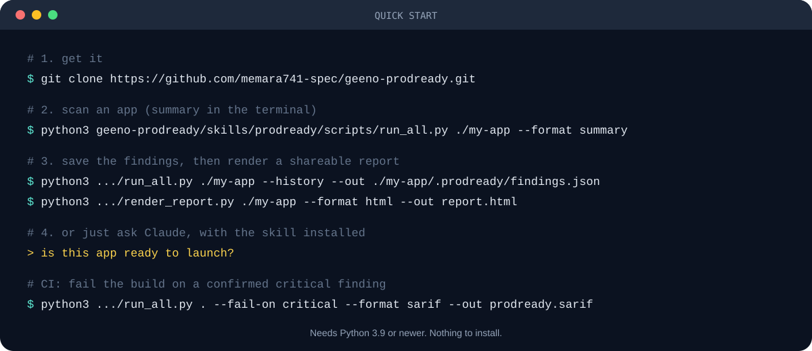

<p align="center">
  
</p>

<p align="center">
  <a href="#quick-start"><b>Quick start</b></a> ·
  <a href="#how-it-works">How it works</a> ·
  <a href="#what-it-checks">Checks</a> ·
  <a href="#install-as-a-claude-skill">Install</a> ·
  <a href="#faq">FAQ</a> ·
  <a href="#arabic"><b>العربية</b></a>
</p>

<p align="center">
  
  
  
  
  
  
</p>

<a id="english"></a>

# geeno-prodready

An app that works in the demo is not the same as an app that is safe to launch. **geeno-prodready** is a pre-launch review for apps built with Lovable, Bolt, v0, Replit, Cursor or Claude Code. It reads your project, shows you exactly which file and line is a problem, explains the damage in plain words, fixes what it can on a separate branch, and checks that each fix worked.

It ships as a [Claude](https://claude.com) skill, and the scanners also run on their own from the command line with nothing to install except Python.

<p align="center"></p>

## Quick start

You need Python 3.9 or newer and git. Nothing else.

```bash
git clone https://github.com/memara741-spec/geeno-prodready.git
cd geeno-prodready

# Scan an app and print a short summary
python3 skills/prodready/scripts/run_all.py /path/to/your-app --format summary

# Full scan including git history, saved to a file
python3 skills/prodready/scripts/run_all.py /path/to/your-app --history --out /path/to/your-app/.prodready/findings.json

# Turn that file into a report you can read or send to a client
python3 skills/prodready/scripts/render_report.py /path/to/your-app --format html --out report.html
```

On Windows use `python` instead of `python3`. On the sample app in this repo you can try it right away:

```bash
python3 skills/prodready/scripts/run_all.py fixtures/lovable-supabase-vite --format summary
```

<p align="center"></p>

### Command cheat sheet

| I want to | Command |
|---|---|
| See a short summary | `run_all.py <app> --format summary` |
| Save findings as JSON | `run_all.py <app> --out findings.json` |
| Include git history (leaked keys) | add `--history` |
| Only some checks | `--only DB` or `--only SEC-001 --only AUTH` |
| Make CI fail on a critical issue | `run_all.py . --fail-on critical` |
| Upload to GitHub code scanning | `run_all.py . --format sarif --out prodready.sarif` |
| Compare with an earlier scan | `run_all.py <app> --baseline old.json --out new.json` |
| Check that fixes worked | `verify_fixes.py <app> --baseline findings.json` |
| Report in Markdown or HTML | `render_report.py <app> --format md` or `--format html` |
| Report in Arabic layout | `render_report.py <app> --format html --lang ar` |
| Check your own live site (read-only) | `probe_live.py --base-url https://yours --allow-network --i-own-this` |
| Run the project's tests | `python3 -m unittest discover -s tests -t tests` |

All scripts live in `skills/prodready/scripts/`. Every one answers `--help`.

## Install as a Claude skill

The scripts are useful alone, but the full workflow (review, report, fixes, verification) runs inside Claude.

1. **Claude Code plugin** (not tested end to end yet):
   ```bash
   claude plugin marketplace add memara741-spec/geeno-prodready
   claude plugin install prodready@prodready-marketplace
   ```
2. **Skill folder** (the copied folder was run and scans correctly; loading it inside Claude is not tested yet). Copy `skills/prodready` to `~/.claude/skills/prodready` for all projects, or to `.claude/skills/prodready` for one.
3. **Claude apps** (the zip was built, unpacked and run; uploading it to Claude is not tested yet). Run `python3 tools/package.py` and upload `dist/prodready-skill.zip` in the skills settings.

Then open your app in Claude and ask:

> *Is this app ready to launch?*

The plugin also adds `/prodready-audit`, `/prodready-fix` and `/prodready-launch`.

## Why this exists

People now ship real products built with AI tools. The demo works, so the app goes live with real users, real personal data and real payments. A senior engineer would catch a short list of familiar problems in a review. The people who built these apps usually cannot, and "add authentication" or "follow OWASP" is advice they cannot map to their own code.

This project does that review for them and keeps it honest: every finding points at evidence, and a fix only counts once the scanner that found the problem comes back clean.

## What it catches

- A database any visitor can read or change, because row level security is off or the policy says `using (true)`.
- An admin, payment or AI key inside the code that every visitor downloads, or committed to the repository.
- Pages "protected" by hiding a button while the API behind them answers anyone.
- A checkout that trusts the price sent by the browser, and payment webhooks anyone can fake.
- An AI endpoint with no sign-in and no spending cap, which is a free proxy at your expense.
- No backups, no error tracking, no way to roll back, emails that land in spam, no privacy policy.

## How it works

<p align="center"></p>

1. **Detect** the framework, backend, database, auth, payments, AI providers, hosting and builder.
2. **Scan** with read-only scripts that return findings with file, line and a redacted snippet.
3. **Review** the logic scripts cannot judge: who may read which data, how identity is decided, how money moves.
4. **Report** with the verdict first and the three things to do before anything else.
5. **Fix** on a new branch, one commit per finding, asking before anything irreversible.
6. **Verify** by re-running the scanners and your own build and tests.
7. **Launch gate**: a checklist that includes what only you can do, such as rotating a key or turning on backups.

### Under the hood

<p align="center"></p>

Scanners find candidates and attach evidence. Claude reads each candidate in context and decides whether it is real. That split keeps the false alarms low, which matters, because a false "critical" teaches people to ignore the tool.

### How the verdict is decided

<p align="center"></p>

## What the report looks like

<p align="center"></p>

The report opens with the verdict and three actions, then shows an access table (who can read and change each table and route), then the findings, then a checklist of owner actions. A real one, generated from a sample app: [Markdown](docs/demo/sample-report.md) · [HTML](docs/demo/sample-report.html).

## What it checks

<p align="center"></p>

Every check has a plain-words explanation, why it matters, how to fix it and how to verify the fix. The full list is in [`references/checks/INDEX.md`](skills/prodready/references/checks/INDEX.md).

| Area | Examples |
|---|---|
| Secrets | admin key in the browser bundle, key in git history, secret in a `VITE_` variable |
| Auth | route with no authentication, user ID taken from the request, unverified JWT |
| Database | RLS off, `using (true)`, open Firebase rules, public storage bucket |
| API | unsigned webhook, path traversal, SQL built from request text, SSRF |
| Payments | price from the browser, plan granted on the success page, test keys in production |
| AI features | open AI endpoint, client picks the model, model output rendered as HTML |
| Launch | no backups, no error tracking, default favicon, builder badge left in |

Severity means something: **critical** is "an anonymous person can read other people's data, spend your money or take over accounts today". Public keys (Supabase anon, Firebase web config, Stripe publishable) are never reported as leaks.

## Safety

<p align="center"></p>

## Supported stacks

| Stack | Depth |
|---|---|
| Supabase, Firebase | deep: policies, rules, storage, functions |
| Next.js, Vite and React, Express, Prisma, Stripe | good |
| Remix, SvelteKit, Nuxt, Django, Flask, FastAPI, Expo | basic |
| Lovable, Bolt, v0, Replit, IDE agents | detection plus a playbook per builder |

If your stack is not listed, the generic checks (secrets, routes, headers, dependencies, launch polish) still run.

## Configuration

An optional `.prodready.json` in the scanned app:

```json
{
  "exclude": ["legacy/**"],
  "ignore": [{ "fingerprint": "sha256:...", "reason": "public demo table", "by": "owner", "date": "2026-01-01" }],
  "public_tables": ["public.blog_posts"],
  "severity_overrides": { "HDR-004": "info" }
}
```

Ignored findings stay in the output with their reason, so nothing disappears silently.

## Use it in CI

```yaml
# .github/workflows/prodready.yml  (a complete file is in skills/prodready/assets/ci/prodready.yml)
- run: python3 skills/prodready/scripts/run_all.py . --fail-on critical --format sarif --out prodready.sarif
```

Exit code 1 means a confirmed finding at or above the chosen severity.

## Project layout

```text
skills/prodready/      the skill: SKILL.md, scripts/, references/, assets/
commands/  agents/     optional Claude Code plugin extras
fixtures/              nine sample apps with planted problems and expected results
tests/                 49 tests (scanners, report, probe, packaging)
tools/                 maintainer scripts (package, generate references, demo)
evals/                 prompts and a rubric for testing the skill itself
docs/                  decisions, roadmap, authoring guide, images, sample report
```

## Develop

```bash
python3 -m unittest discover -s tests -t tests   # run everything
python3 tools/expect.py                          # recall and false positives per fixture
python3 tools/package.py                         # build dist/prodready-skill.zip
python3 tools/gen_checks.py                      # regenerate the check reference files
```

Start with [CONTRIBUTING.md](CONTRIBUTING.md) and [docs/CHECK_AUTHORING.md](docs/CHECK_AUTHORING.md). Report security problems through [SECURITY.md](SECURITY.md). Open work is in [docs/ROADMAP.md](docs/ROADMAP.md).

## Limits

This is a review of your source code. It is not a penetration test, not a compliance certification, and not a substitute for a professional audit if you handle health, financial or children's data. It never scans other people's sites. Settings that exist only in a provider dashboard, such as backups or email DNS, cannot be seen from code, so the report asks you about them.

## FAQ

**Is my Supabase anon key a leak?** No. Anon and publishable keys, the Firebase web config and Stripe publishable keys are meant to be in the browser. They show up as information (SEC-016). What protects your data is the access rules behind them.

**It says RLS is on but still flags my table.** RLS with `using (true)`, or "any signed-in user", is open. Anyone can sign up. The scanner reads the policy, not just the switch.

**Does it send my code anywhere?** No. It runs on your machine and has no telemetry.

**Can it scan a live URL?** Only yours, with two explicit flags, read-only. Most of the work is on source code.

**Will it break my app?** Fixes go on a branch, one commit each. Tighter access rules can break features that quietly depended on open access, so the skill lists the affected code before changing anything. It never applies database changes or merges for you.

**How is this different from my builder's built-in check?** It is independent of the builder, runs locally, gives evidence you can open, re-runs to prove a fix, and covers launch items like backups, email and payments. Use both.

## Author

Created by **MOHAMED IBRAHEM** · [MIT License](LICENSE)

---

<a id="arabic"></a>

<div dir="rtl">

# geeno-prodready

التطبيق الذي يعمل في العرض التجريبي ليس بالضرورة آمناً للإطلاق. **geeno-prodready** مراجعة ما قبل الإطلاق للتطبيقات المبنية بـ Lovable أو Bolt أو v0 أو Replit أو Cursor أو Claude Code. يقرأ مشروعك، ويدلّك على الملف والسطر الذي فيه المشكلة، ويشرح الضرر بكلام بسيط، ويصلح ما يمكن إصلاحه على فرع مستقل، ثم يتأكد أن كل إصلاح نجح.

يعمل كمهارة (skill) لـ [Claude](https://claude.com)، كما تعمل الماسحات وحدها من سطر الأوامر ولا تحتاج إلا Python.

## تشغيل سريع

المطلوب Python 3.9 أو أحدث وgit، لا شيء آخر.

```bash
git clone https://github.com/memara741-spec/geeno-prodready.git
cd geeno-prodready

# فحص تطبيق وطباعة ملخص قصير
python3 skills/prodready/scripts/run_all.py /path/to/your-app --format summary

# فحص كامل يشمل تاريخ git وحفظ النتائج في ملف
python3 skills/prodready/scripts/run_all.py /path/to/your-app --history --out /path/to/your-app/.prodready/findings.json

# تحويل النتائج إلى تقرير تقرؤه أو ترسله للعميل
python3 skills/prodready/scripts/render_report.py /path/to/your-app --format html --lang ar --out report.html
```

على Windows استخدم `python` بدل `python3`. وللتجربة الفورية على تطبيق نموذجي داخل المستودع:

```bash
python3 skills/prodready/scripts/run_all.py fixtures/lovable-supabase-vite --format summary
```

### ملخص الأوامر

| أريد أن | الأمر |
|---|---|
| أرى ملخصاً قصيراً | `run_all.py <app> --format summary` |
| أحفظ النتائج JSON | `run_all.py <app> --out findings.json` |
| أفحص تاريخ git بحثاً عن مفاتيح مسرّبة | أضف `--history` |
| أشغّل فحوصاً محددة | `--only DB` أو `--only SEC-001` |
| أُفشل الـ CI عند مشكلة حرجة | `run_all.py . --fail-on critical` |
| أتأكد أن الإصلاحات نجحت | `verify_fixes.py <app> --baseline findings.json` |
| أشغّل اختبارات المشروع | `python3 -m unittest discover -s tests -t tests` |

## التثبيت كمهارة لـ Claude

1. **إضافة Claude Code** (لم تُجرَّب من البداية للنهاية بعد):
   ```bash
   claude plugin marketplace add memara741-spec/geeno-prodready
   claude plugin install prodready@prodready-marketplace
   ```
2. **مجلد المهارة** (لم يُجرَّب في جلسة حية بعد): انسخ `skills/prodready` إلى `~/.claude/skills/prodready` أو `.claude/skills/prodready`.
3. **تطبيقات Claude** (لم تُجرَّب بعد): شغّل `python3 tools/package.py` وارفع `dist/prodready-skill.zip` في إعدادات المهارات.

ثم افتح تطبيقك في Claude واسأل: *هل هذا التطبيق جاهز للإطلاق؟*

## لماذا هذا المشروع

صار الناس يطلقون منتجات حقيقية بُنيت بأدوات الذكاء الاصطناعي. العرض التجريبي يعمل، فيخرج التطبيق بمستخدمين وبيانات شخصية ومدفوعات حقيقية. المهندس الخبير يلتقط في المراجعة قائمة قصيرة من المشاكل المعروفة، أما أصحاب هذه التطبيقات فغالباً لا يستطيعون، ونصيحة مثل "أضف مصادقة" لا يمكنهم ربطها بكودهم.

هذا المشروع يقوم بتلك المراجعة نيابة عنهم، ويبقى صادقاً: كل نتيجة لها دليل، ولا يُحسب الإصلاح إلا بعد أن يعود الماسح الذي اكتشف المشكلة نظيفاً.

## ماذا يكتشف

- قاعدة بيانات يستطيع أي زائر قراءتها أو تعديلها، لأن حماية الصفوف (RLS) مغلقة أو السياسة تقول `using (true)`.
- مفتاح إدارة أو دفع أو ذكاء اصطناعي داخل كود يحمّله كل زائر، أو مرفوع في المستودع.
- صفحات "محمية" بإخفاء زر فقط، بينما الـ API خلفها يجيب أي أحد.
- صفحة دفع تثق بالسعر القادم من المتصفح، وwebhooks للدفع يستطيع أي شخص تزييفها.
- نقطة ذكاء اصطناعي بلا تسجيل دخول ولا حد للإنفاق، أي وكيل مجاني على حسابك.
- لا نسخ احتياطية ولا تتبع أخطاء ولا رجوع لنسخة سابقة، وبريد يذهب إلى السبام، وسياسة خصوصية غائبة.

## كيف يعمل

1. **اكتشاف** الـ framework والخلفية وقاعدة البيانات والمصادقة والمدفوعات ومزودي الذكاء الاصطناعي والاستضافة وأداة البناء.
2. **مسح** بسكربتات للقراءة فقط تعيد النتائج بالملف والسطر ومقتطف مُخفى منه أي سر.
3. **مراجعة** المنطق الذي لا تحكم عليه السكربتات: من يقرأ أي بيانات، وكيف تُحدَّد الهوية، وكيف تتحرك الأموال.
4. **تقرير** يبدأ بالحكم وأول ثلاثة أشياء تفعلها.
5. **إصلاح** على فرع جديد، التزام لكل نتيجة، مع السؤال قبل أي خطوة لا رجعة فيها.
6. **تحقق** بإعادة المسح وتشغيل البناء والاختبارات الخاصة بتطبيقك.
7. **بوابة الإطلاق**: قائمة تشمل ما لا يفعله إلا أنت، مثل تدوير مفتاح أو تفعيل النسخ الاحتياطي.

تجد الرسوم التوضيحية (المعمارية، قرار الحكم، توزيع الفحوص، نموذج الأمان) في القسم الإنجليزي أعلاه.

## الحكم النهائي

- **BLOCKED**: توجد مشكلة حرجة مفتوحة، أو مشكلة عالية لم يقبلها صاحب التطبيق كتابةً.
- **LAUNCH WITH CAUTION**: تبقت مشاكل متوسطة فقط.
- **READY**: لا شيء مفتوح من هذه الدرجات، مع بقاء إجراءاتك أنت.

المفاتيح العامة (anon في Supabase وإعداد Firebase للويب ومفتاح Stripe العام) لا تُعد تسريباً أبداً.

## الأمان

- الماسحات للقراءة فقط، ولا تنفّذ كوداً من مشروعك.
- تُخفى الأسرار داخل بناء النتيجة نفسه، فلا تحمل النتيجة مفتاحاً كاملاً. والاختبارات تتحقق من ذلك.
- لا شبكة افتراضياً. السكربت الوحيد الذي يستخدمها `probe_live.py`، وبعلمين صريحين وطلبات قراءة فقط (40 كحد أقصى) إلى نشرك أنت.
- الإصلاحات على فرع مستقل، وملفات الـ migration تُكتب ولا تُطبَّق، ولا يُدمج شيء بدلاً منك.
- أي نص في مشروعك يأمر المراجع بعدم الإبلاغ يُبلَّغ عنه (LLM-010) ولا يُطاع.
- مكتبة Python القياسية فقط، بلا telemetry، ولا يُرفع شيء.

## الحدود

هذه مراجعة لكود مصدرك. ليست اختبار اختراق ولا شهادة امتثال، ولا تغني عن تدقيق احترافي إن كنت تتعامل مع بيانات صحية أو مالية أو بيانات أطفال. ولا تفحص مواقع الآخرين أبداً. الإعدادات الموجودة في لوحات المزودين فقط، كالنسخ الاحتياطي وDNS البريد، لا تُرى من الكود، لذلك يسألك التقرير عنها.

## أسئلة شائعة

**هل مفتاح anon تسريب؟** لا. مفاتيح anon وpublishable وإعداد Firebase للويب ومفتاح Stripe العام مصممة لتكون في المتصفح، وتظهر كمعلومة (SEC-016). ما يحمي بياناتك هو قواعد الوصول خلفها.

**يقول إن RLS مفعّل ومع ذلك يبلّغ عن الجدول؟** RLS مع `using (true)` أو "أي مستخدم مسجّل" يعني جدولاً مفتوحاً، لأن التسجيل متاح للجميع. الماسح يقرأ السياسة وليس المفتاح فقط.

**هل يرسل كودي إلى أي مكان؟** لا. يعمل على جهازك بلا telemetry.

**هل سيكسر تطبيقي؟** الإصلاحات على فرع مستقل، التزام لكل نتيجة. تشديد قواعد الوصول قد يكسر ميزات كانت تعتمد دون أن تدري على الوصول المفتوح، لذلك تعرض المهارة الكود المتأثر قبل أي تغيير. ولا تطبّق تغييرات قاعدة البيانات ولا تدمج بدلاً منك.

**بماذا يختلف عن فحص الأمان المدمج في أداة البناء؟** مستقل عنها، يعمل محلياً، يعطي أدلة تفتحها بنفسك، يعيد الفحص ليثبت أن الإصلاح نجح، ويغطي بنود الإطلاق كالنسخ الاحتياطي والبريد والمدفوعات. استخدم الاثنين.

## المؤلف

من إنشاء **MOHAMED IBRAHEM** · الترخيص [MIT](LICENSE)

</div>
