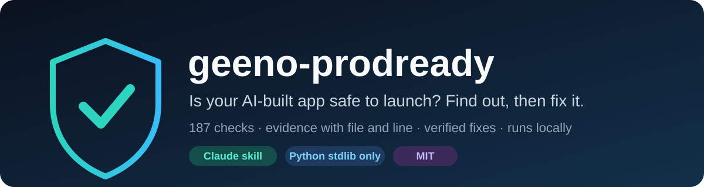
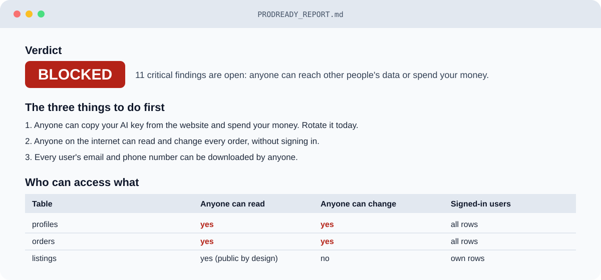

<p align="center">
  
</p>

<p align="center">
  <a href="#english">English</a> · <a href="#arabic">العربية</a> · <a href="https://github.com/memara741-spec/geeno-prodready/blob/main/docs/demo/sample-report.md">Sample report</a>
</p>

<p align="center">
  
  
  
  
  
</p>

<a id="english"></a>

# geeno-prodready

**Find out if your AI-built app is safe to launch, and fix what is not.**

geeno-prodready is a skill for [Claude](https://claude.com) (Claude Code and the Claude apps). Ask "is my app ready to launch?" and it detects your stack, runs scanners that point at the exact file and line, reads the code the scanners cannot judge, writes a plain-language report that starts with a verdict, then fixes problems on a branch and re-checks them.

Created by **MOHAMED IBRAHEM**.

<p align="center"></p>

## Why it matters

Many people now build real apps with Lovable, Bolt, v0, Replit, Cursor or Claude Code. The demo works, so it goes live with real users, real personal data and real payments. Experienced engineers catch a familiar set of problems in a pre-launch review; the people who built these apps often do not know what they do not know. Generic advice such as "add authentication" or "follow OWASP" does not help, because they cannot map it to their code. This project turns that review into something repeatable: concrete findings, in their own code, explained in words they understand, and fixed and verified.

## The problems it solves

- A database that any visitor can read or write, because row level security is off or the policy allows everything.
- An admin, payment or AI key shipped inside the browser code, or committed to a repository.
- Pages "protected" only by hiding a button, while the API behind them answers anyone.
- A checkout that trusts the price sent by the browser, or a payment webhook that anyone can fake.
- An AI endpoint with no sign-in and no spending cap: a free proxy at your expense.
- No backups, no error tracking, no rollback, emails that land in spam, no privacy policy.

## Features

- **Evidence, not advice.** Every finding has a file, a line and a redacted snippet. No evidence, no finding.
- **Verification by execution.** A fix is done only when the scanner that found the problem is re-run and passes; the report shows before and after.
- **Stack-aware.** Supabase policies, Firebase rules, Next.js server actions and public env prefixes, Vite env exposure, Stripe webhooks, and the default layouts of Lovable, Bolt, v0 and Replit.
- **Written for non-engineers.** Each finding starts with one plain sentence: who can do what to which asset.
- **187 checks in 18 categories**, with honest severity and confidence. Public keys (Supabase anon, Firebase web config, Stripe publishable) are never reported as leaks.
- **Access matrix.** For every table or collection and every route: who can read, who can change.
- **Safe fixes.** Own branch, one commit per finding, database changes written as migration files that you apply, nothing merged or pushed for you.
- **Private and local.** Python standard library only, no install, no telemetry, nothing uploaded. Scanners are read-only and never print a secret.
- **Injection resistant.** Text in your project that tries to give orders to an AI reviewer is reported (LLM-010), never obeyed.
- **CI ready.** `--fail-on critical` and SARIF output for GitHub code scanning.

## How it works

<p align="center"></p>

1. **Detect** the framework, backend, database, auth, payments, AI providers, hosting and builder.
2. **Scan** with read-only scripts that produce findings with evidence.
3. **Review** the logic scripts cannot judge: who may read which data, how identity is decided, how money moves.
4. **Report** with the verdict first (`BLOCKED`, `LAUNCH WITH CAUTION` or `READY`) and the three things to do first.
5. **Fix** on a branch, one commit per finding, asking before anything irreversible.
6. **Verify** by re-running the scanners and your own build and tests.
7. **Launch gate**: a checklist that includes what only you can do (rotate a key, enable backups, set up email DNS).

## What you get

<p align="center"></p>

A report that opens with the verdict and three actions, an access table, findings with evidence, and a checklist of owner actions. See the real output on a sample app: [`docs/demo/sample-report.md`](docs/demo/sample-report.md) and [`.html`](docs/demo/sample-report.html).

## What it checks

| Category | Checks | Examples |
|---|---|---|
| Secrets (SEC) | 16 | admin key in the browser bundle; secret in git history |
| Auth (AUTH) | 18 | route with no authentication; client-supplied user ID |
| Database (DB) | 24 | RLS off; `using (true)`; open Firebase rules |
| API (API) | 19 | unverified webhook; path traversal; SSRF |
| Payments (PAY) | 11 | price taken from the browser; unsigned payment webhook |
| Uploads (UP) | 6 | no size or type limits; permanent public URLs for private files |
| AI features (LLM) | 10 | open AI endpoint; client chooses the model; injection text |
| Frontend (FE) | 9 | raw HTML sinks; no error boundary |
| Headers (HDR) | 6 | no CSP; no HSTS |
| Deployment (DEP) | 14 | dev server in production; build ignores type errors |
| Dependencies (DEPS) | 7 | known vulnerable versions; misspelled packages |
| Privacy (PRIV) | 8 | no privacy policy; no account deletion |
| Observability, Reliability, Performance, Email, Tests, Launch | 8, 8, 6, 5, 4, 10 | no error tracking; no backups; N+1 queries; SPF/DKIM; no CI; default favicon |

Full list: [`skills/prodready/references/checks/INDEX.md`](skills/prodready/references/checks/INDEX.md).

## Who it is for

Solo founders and small teams who built with an AI builder and are about to launch; freelancers and agencies who need a repeatable review and a client-ready report; developers who want a second pair of eyes before shipping.

## Install

Everything the skill needs is inside `skills/prodready/`. Paths marked "not yet tested" have not been verified end to end.

1. **Claude Code plugin marketplace** (not yet tested):
   ```bash
   claude plugin marketplace add memara741-spec/geeno-prodready
   claude plugin install prodready@prodready-marketplace
   ```
2. **Skill folder** (not yet tested in a live session): copy `skills/prodready` to `~/.claude/skills/prodready` (all projects) or `.claude/skills/prodready` (one project).
3. **Claude apps** (not yet tested): download `prodready-skill.zip` from the latest release, or run `python3 tools/package.py`, and upload it in the skills settings.
4. **Other agents** that read the same skill format can use the folder as is. The scripts need only Python 3.9 or newer.

## Use

Say: "Is this app ready to launch?", "Audit my Supabase app before I go live", or "I built this with an AI, can you check the security?". Plugin commands: `/prodready-audit`, `/prodready-fix <IDs or severity>`, `/prodready-launch`.

You can also run the scanners yourself:

```bash
python3 skills/prodready/scripts/run_all.py path/to/app --format summary
python3 skills/prodready/scripts/run_all.py path/to/app --out .prodready/findings.json
python3 skills/prodready/scripts/render_report.py path/to/app --format html --out report.html
```

## Safety and privacy

Runs locally; no telemetry; nothing is uploaded. Scanners are read-only, use only the standard library, and redact any secret when a finding is created. The only script that touches the network is `probe_live.py`; it refuses to run without `--allow-network` and `--i-own-this`, sends at most 40 read-only requests, and only to your own deployment. The skill treats everything in your project as data.

## Supported stacks

| Stack | Support |
|---|---|
| Supabase, Firebase | deep |
| Next.js, Vite/React, Express, Prisma, Stripe | good |
| Remix, SvelteKit, Nuxt, Django, Flask, FastAPI, Expo | basic |
| Lovable, Bolt, v0, Replit, IDE agents | detection plus a playbook per builder |

## Limits

Not a penetration test, not a compliance certification, not a replacement for a professional audit when you handle health, financial or children's data, and not a code-style linter. It reviews your own source and never scans other people's sites.

## CI

```bash
python3 skills/prodready/scripts/run_all.py . --fail-on critical --format sarif --out prodready.sarif
```

Exit code 1 means a confirmed finding at or above the severity. A ready workflow: [`skills/prodready/assets/ci/prodready.yml`](skills/prodready/assets/ci/prodready.yml). Optional configuration in `.prodready.json`: `exclude`, `ignore` (with reasons), `public_tables`, `severity_overrides`.

## Develop

```bash
python3 -m unittest discover -s tests -t tests   # 49 tests
python3 tools/expect.py                          # recall and false positives per fixture
python3 tools/package.py                         # builds dist/prodready-skill.zip
```

Read [CONTRIBUTING.md](CONTRIBUTING.md) and [docs/CHECK_AUTHORING.md](docs/CHECK_AUTHORING.md). Report vulnerabilities via [SECURITY.md](SECURITY.md). What is not done yet is in [docs/ROADMAP.md](docs/ROADMAP.md).

## FAQ

**Is my anon key a leak?** No. Supabase publishable and anon keys, the Firebase web config and Stripe publishable keys are meant to be public. They are reported as info (SEC-016). What matters is the access rules behind them.

**It says RLS is enabled but still flags the table.** Enabled with `using (true)`, or "any signed-in user", is open. The policy is classified, not just the flag.

**Can it scan a live URL?** Only your own, with explicit consent flags, read-only. Its main work is on source code.

**Does it send my code anywhere?** No.

**Will it break my app?** Fixes are made on a branch, one commit each. Tightening access rules can break features that relied on open access, so the skill lists the affected code paths first. It never applies database changes or merges for you.

**My stack is not listed.** Generic checks (secrets, routes, headers, dependencies, launch polish) still run; deep checks cover the listed stacks.

**How is this different from the builder's own security check?** It is independent, runs on your machine, gives file and line evidence, verifies fixes by re-running, and covers launch items such as backups, email and payments. Use both.

## Author and licence

Created by **MOHAMED IBRAHEM**. Licensed under the [MIT License](LICENSE).

---

<a id="arabic"></a>

<div dir="rtl">

# geeno-prodready

**اعرف إن كان تطبيقك المبني بالذكاء الاصطناعي آمناً للإطلاق، وأصلح ما ليس آمناً.**

geeno-prodready مهارة (skill) لـ [Claude](https://claude.com) (Claude Code وتطبيقات Claude). اسأل "هل تطبيقي جاهز للإطلاق؟" فيكتشف الـ stack الذي بنيت به، ويشغّل ماسحات تشير إلى الملف والسطر بالضبط، ويقرأ الكود الذي لا تستطيع الماسحات الحكم عليه، ثم يكتب تقريراً بلغة بسيطة يبدأ بالحكم النهائي، ثم يصلح المشاكل على فرع مستقل ويعيد التحقق منها.

من إنشاء **MOHAMED IBRAHEM**.

## لماذا هو مهم

يبني كثيرون اليوم تطبيقات حقيقية بأدوات مثل Lovable وBolt وv0 وReplit وCursor وClaude Code. يعمل العرض التجريبي فيُنشر مباشرة بمستخدمين وبيانات شخصية ومدفوعات حقيقية. يلتقط المهندس الخبير مجموعة مألوفة من المشاكل في مراجعة ما قبل الإطلاق، بينما أصحاب هذه التطبيقات لا يعرفون غالباً ما لا يعرفونه. النصائح العامة مثل "أضف مصادقة" أو "اتبع OWASP" لا تفيدهم لأنهم لا يستطيعون ربطها بكودهم. هذا المشروع يحوّل تلك المراجعة إلى عملية قابلة للتكرار: نتائج محددة في كودهم، مشروحة بكلمات يفهمونها، ثم تُصلَح ويُتحقَّق منها.

## المشاكل التي يحلها

- قاعدة بيانات يستطيع أي زائر قراءتها أو الكتابة فيها، لأن حماية الصفوف (RLS) مغلقة أو لأن السياسة تسمح بكل شيء.
- مفتاح إدارة أو دفع أو ذكاء اصطناعي داخل كود المتصفح أو مرفوع في المستودع.
- صفحات "محمية" بإخفاء زر فقط، بينما الـ API خلفها يجيب أي أحد.
- صفحة دفع تثق بالسعر المرسل من المتصفح، أو webhook للدفع يستطيع أي شخص تزييفه.
- نقطة ذكاء اصطناعي بلا تسجيل دخول ولا حد للإنفاق: وكيل مجاني على حسابك.
- لا نسخ احتياطية ولا تتبع أخطاء ولا رجوع لنسخة سابقة، وبريد يذهب إلى السبام، وسياسة خصوصية غائبة.

## المميزات

- **أدلة لا نصائح.** لكل نتيجة ملف وسطر ومقتطف مُخفى منه أي سر. بلا دليل لا توجد نتيجة.
- **تحقق بالتنفيذ.** لا يُعد الإصلاح منتهياً حتى يُعاد تشغيل الماسح الذي اكتشف المشكلة ويمر؛ ويعرض التقرير قبل وبعد.
- **يعرف الـ stack.** سياسات Supabase وقواعد Firebase وإجراءات Next.js وبادئات المتغيرات العامة وتسريب Vite وwebhooks في Stripe وتخطيطات Lovable وBolt وv0 وReplit.
- **مكتوب لغير المهندسين.** كل نتيجة تبدأ بجملة بسيطة: من يستطيع فعل ماذا بأي أصل.
- **187 فحصاً في 18 فئة** بدرجة خطورة وثقة صادقتين. المفاتيح العامة (anon وإعداد Firebase للويب ومفتاح Stripe العام) لا تُعد تسريباً أبداً.
- **مصفوفة وصول.** لكل جدول ومسار: من يستطيع القراءة ومن يستطيع التعديل.
- **إصلاحات آمنة.** فرع مستقل، التزام واحد لكل نتيجة، تغييرات قاعدة البيانات تُكتب كملفات migration تطبّقها أنت، ولا يدمج ولا يدفع شيئاً بدلاً منك.
- **خاص ومحلي.** مكتبة Python القياسية فقط بلا تثبيت، بلا telemetry، ولا يُرفع شيء. الماسحات للقراءة فقط ولا تطبع أي سر.
- **مقاوم للحقن.** أي نص في مشروعك يحاول إعطاء أوامر لمراجع ذكاء اصطناعي يُبلَّغ عنه (LLM-010) ولا يُطاع.
- **جاهز للـ CI.** `--fail-on critical` ومخرجات SARIF لفحص الكود في GitHub.

## كيف يعمل

1. **اكتشاف** الـ framework والخلفية وقاعدة البيانات والمصادقة والمدفوعات ومزودي الذكاء الاصطناعي والاستضافة وأداة البناء.
2. **مسح** بسكربتات للقراءة فقط تنتج نتائج مع أدلة.
3. **مراجعة** المنطق الذي لا تحكم عليه السكربتات: من يقرأ أي بيانات، وكيف تُحدَّد الهوية، وكيف تتحرك الأموال.
4. **تقرير** يبدأ بالحكم (`BLOCKED` أو `LAUNCH WITH CAUTION` أو `READY`) وأول ثلاثة أشياء يجب فعلها.
5. **إصلاح** على فرع، التزام لكل نتيجة، مع السؤال قبل أي شيء لا رجعة فيه.
6. **تحقق** بإعادة المسح وتشغيل البناء والاختبارات الخاصة بتطبيقك.
7. **بوابة الإطلاق**: قائمة تشمل ما لا يفعله إلا أنت (تدوير مفتاح، تفعيل النسخ الاحتياطي، إعداد DNS للبريد).

## ماذا ستحصل عليه

تقرير يفتح بالحكم وثلاثة إجراءات، وجدول وصول، ونتائج بأدلة، وقائمة بإجراءاتك أنت. شاهد مخرجات حقيقية على تطبيق تجريبي: [`docs/demo/sample-report.md`](docs/demo/sample-report.md) و[`.html`](docs/demo/sample-report.html).

## ماذا يفحص

الأسرار والمفاتيح، المصادقة، قواعد البيانات والتخزين، نقاط الخادم، المدفوعات، رفع الملفات، ميزات الذكاء الاصطناعي، الواجهة، ترويسات الأمان، النشر، الاعتماديات، الخصوصية، المراقبة، الموثوقية، الأداء، البريد، الاختبارات، وتفاصيل الإطلاق. القائمة الكاملة: [`INDEX.md`](skills/prodready/references/checks/INDEX.md).

## لمن هو

للمؤسسين المنفردين والفرق الصغيرة التي بنت بأداة ذكاء اصطناعي وعلى وشك الإطلاق، وللمستقلين والوكالات الذين يحتاجون مراجعة قابلة للتكرار وتقريراً يُسلَّم للعميل، وللمطورين الذين يريدون عيناً ثانية قبل النشر.

## التثبيت

كل ما تحتاجه المهارة داخل `skills/prodready/`. الطرق الموسومة "لم تُجرَّب بعد" لم يُتحقق منها من البداية للنهاية.

1. **سوق إضافات Claude Code** (لم يُجرَّب بعد):
   ```bash
   claude plugin marketplace add memara741-spec/geeno-prodready
   claude plugin install prodready@prodready-marketplace
   ```
2. **مجلد المهارة** (لم يُجرَّب في جلسة حية): انسخ `skills/prodready` إلى `~/.claude/skills/prodready` أو `.claude/skills/prodready`.
3. **تطبيقات Claude** (لم يُجرَّب بعد): نزّل `prodready-skill.zip` من الإصدار الأحدث أو شغّل `python3 tools/package.py` وارفعه في إعدادات المهارات.
4. **وكلاء آخرون** يقرؤون نفس الصيغة: المجلد قابل للنقل والسكربتات تحتاج Python 3.9 أو أحدث فقط.

## الاستخدام

قل: "هل تطبيقي جاهز للإطلاق؟" أو "افحص تطبيقي على Supabase قبل النشر". أوامر الإضافة: `/prodready-audit` و`/prodready-fix` و`/prodready-launch`. ويمكنك تشغيل الماسحات بنفسك:

```bash
python3 skills/prodready/scripts/run_all.py path/to/app --format summary
```

## الأمان والخصوصية

يعمل محلياً بلا telemetry ولا يُرفع شيء. الماسحات للقراءة فقط وتخفي أي سر عند إنشاء النتيجة. السكربت الوحيد الذي يستخدم الشبكة هو `probe_live.py` ويرفض العمل بدون `--allow-network` و`--i-own-this`، ويرسل 40 طلب قراءة كحد أقصى إلى نشرك أنت فقط.

## الحدود

ليس اختبار اختراق، وليس شهادة امتثال، ولا يغني عن تدقيق احترافي إن كنت تتعامل مع بيانات صحية أو مالية أو بيانات أطفال، وليس أداة تنسيق كود. يراجع مصدرك أنت ولا يفحص مواقع الآخرين.

## الأسئلة الشائعة

**هل مفتاح anon تسريب؟** لا. مفاتيح Supabase العامة وإعداد Firebase للويب ومفاتيح Stripe العامة مصممة لتكون عامة وتُسجَّل كمعلومة (SEC-016). المهم قواعد الوصول خلفها.

**يقول إن RLS مفعّل ومع ذلك يبلغ عن الجدول؟** سياسة `using (true)` أو "أي مستخدم مسجّل" تعني جدولاً مفتوحاً. الأداة تصنّف السياسة وليس العلم فقط.

**هل يرسل شيفرتي إلى أي مكان؟** لا.

**هل سيكسر تطبيقي؟** الإصلاحات على فرع مستقل، التزام لكل نتيجة. تشديد قواعد الوصول قد يكسر ميزات اعتمدت على الوصول المفتوح، لذلك تعرض المهارة المسارات المتأثرة أولاً. لا تطبّق تغييرات قاعدة البيانات ولا تدمج بدلاً منك.

**كيف يختلف عن فحص الأمان المدمج في أداة البناء؟** مستقل، يعمل على جهازك، يعطي أدلة بالملف والسطر، يتحقق من الإصلاح بإعادة المسح، ويغطي بنود الإطلاق مثل النسخ الاحتياطي والبريد والمدفوعات. استخدم الاثنين.

## المؤلف والترخيص

من إنشاء **MOHAMED IBRAHEM**. الترخيص: [MIT](LICENSE).

</div>
